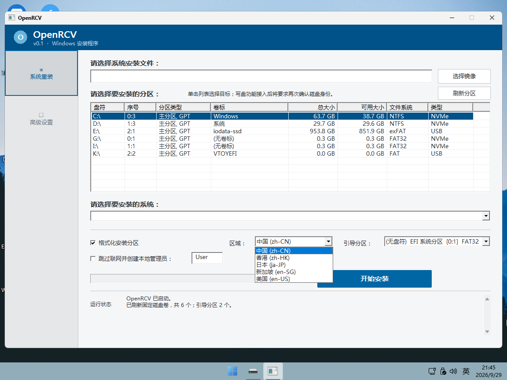
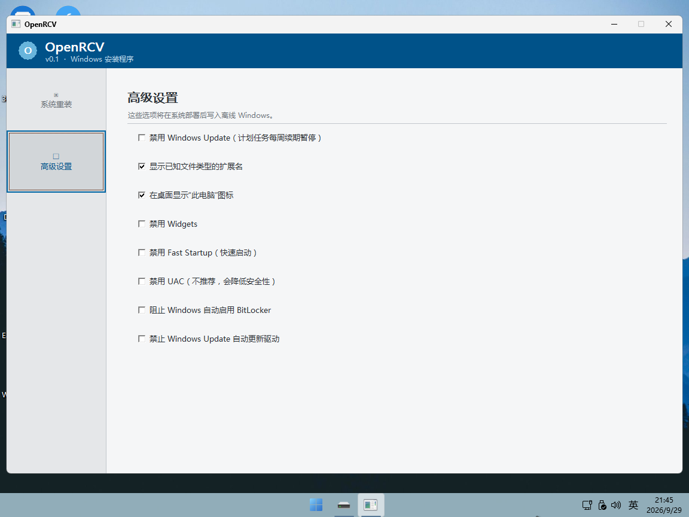

# OpenRCV

OpenRCV 是一款面向 Windows 预安装环境（WinPE）的系统部署工具。

它提供图形界面，用于选择 Windows 镜像、目标分区和安装选项，并完成 Windows 系统部署。

目前支持 Windows 10 和 Windows 11 官方 ISO 镜像。

不支持 Ghost、GHO、第三方封装镜像或其他非标准 Windows 安装镜像。

## 界面截图

系统重装：

高级设置：

## 功能

- 挂载 Windows 10 / Windows 11 ISO 镜像
- 读取 WIM / ESD 中的 Windows 版本
- 选择系统安装分区
- 选择 EFI / 引导分区
- 配置无人值守安装选项
- 格式化目标分区
- 应用 Windows 镜像
- 配置 Windows 启动文件
- 显示部署进度和运行日志
- 将 Windows Update 配置为仅通知下载和安装（Home 使用离线注册表，Pro
  及以上使用本地计算机策略）

## 支持环境

目前主要针对 Windows 11 x64 WinPE 进行开发和测试。

## 项目状态

OpenRCV 目前仍处于开发阶段，部分功能和界面可能继续调整。
